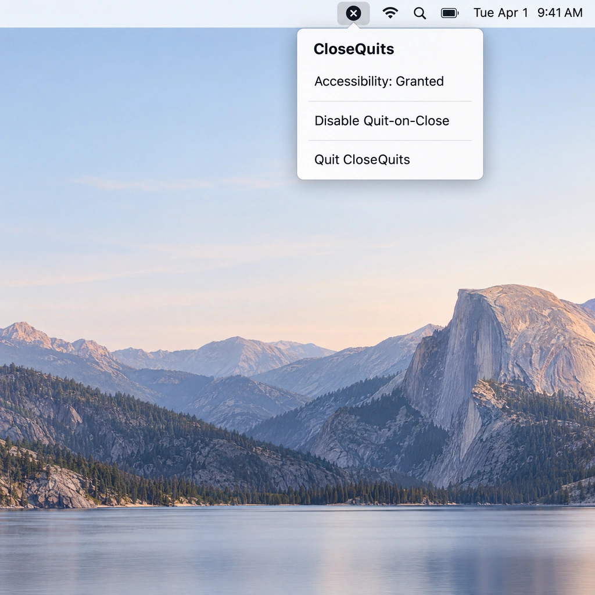

# CloseQuits

A tiny macOS menu-bar utility that makes an app's red close (×) button **quit the app** instead of
just closing its window — because the minimize (yellow) button already exists for hiding windows.



## Features

- **Quit on close** — clicking the red × on an app's last window quits the app (`terminate()`), so
  unsaved-changes prompts still appear as usual.
- **Fully quit, nothing left in the background** — if the app hasn't exited 5 s later and isn't
  showing any window (such as a quit confirmation), it is force-quit. Then everything it left
  behind is terminated: helpers, agents and XPC services inside its `.app` bundle, and background
  processes it spawned elsewhere (e.g. a `git fsmonitor--daemon` started by an editor) that would
  otherwise keep its Dock icon showing as running in the background.
- **Only when the window really closed** — the app is quit only after the click finishes and its
  last window is actually gone. Dragging off the button, cancelling a "Save?" sheet, or closing one
  of several windows leaves the app running.
- **Auxiliary windows close normally** — Quick Look previews, panels and other non-main windows are
  never treated as a quit.
- **Spaces-aware** — windows open on other desktops count, so an app is not quit while it still has
  a window on another Space.
- **System-wide, zero input lag** — the event tap only hands clicks to a background Accessibility check,
  so clicks are never delayed, even when the app under the cursor is hung.
- **Menu-bar only** — runs as an `LSUIElement` with no Dock icon and a negligible footprint.
- **Enable/disable** — toggle the behavior from the menu bar icon at any time.
- **Finder-safe** — Finder is excluded so the desktop/icons are never killed.
- **QuickShare-Mac-safe** — QuickShare-Mac (`tools.macexplorer.quickshare`) is excluded so its Send
  window (transfers, PIN confirmation, QR wake) always closes normally instead of quitting the app.
- **Universal binary** — Apple Silicon and Intel, macOS 13 or later.
- **No third-party dependencies** — pure AppKit/ApplicationServices, ad-hoc signed.

## Requirements

- macOS 13 or later
- Accessibility permission (see [Permissions](#permissions))
- To build from source: Xcode Command Line Tools (`xcode-select --install`); Xcode 16+ also works

## Install

### Option 1: DMG (easiest)

1. Open `release/CloseQuits-1.1.0.dmg`
2. Drag **CloseQuits.app** into **Applications**
3. Open it from Applications (right-click → **Open** the first time, since the build is ad-hoc signed)

### Option 2: Build from source

```bash
./build.sh release
cp -R "$HOME/Library/Caches/CloseQuitsBuild/CloseQuits.app" /Applications/
open "/Applications/CloseQuits.app"
```

### Option 3: Build and package a DMG

```bash
./package.sh          # builds universal app, writes release/CloseQuits-<version>.dmg
```

## Permissions

CloseQuits needs **Accessibility** access to read the UI element under the cursor and create the
event tap:

1. Open the menu-bar icon → **Grant Accessibility Access…** (shows the system prompt with an
   **Open System Settings** button), or go to **System Settings → Privacy & Security →
   Accessibility**.
2. Enable **CloseQuits**.
3. Within ~2 seconds the menu shows *Accessibility: Granted* and the tap starts — no relaunch
   needed. Revoking access stops the tap the same way.

> **After updating or rebuilding:** the app is ad-hoc signed, so every new build has a different
> signature and macOS silently stops trusting it, even though the switch in Settings still looks
> on. Remove CloseQuits from the Accessibility list (−) and add it again.

## Usage

| Action | How |
| --- | --- |
| Quit an app by closing it | Click the red × on any window |
| Enable / disable | Menu bar icon → **Quit on Close** (checkmark = on; greyed out until Accessibility is granted) |
| Check permission status | Menu bar icon shows *Accessibility: Granted* or *Grant Accessibility Access…* |
| Quit CloseQuits | Menu bar icon → **Quit CloseQuits** (or `⌘Q` with menu open) |

Minimize (yellow) and zoom (green) keep their normal behavior. The menu-bar icon is dimmed whenever
quit-on-close is not active (disabled or no Accessibility access).

## How it works

- A `CGEvent` tap (active, which needs only Accessibility — listen-only taps would also need Input Monitoring) observes left mouse down/up and hands the location to a background
  queue, so the tap never blocks input. Accessibility calls have a 0.25 s timeout.
- On mouse-down, `AXUIElementCopyElementAtPosition` finds the element under the cursor. It is a
  candidate only if it has the `AXCloseButton` subrole (or is a button equal to its window's
  `kAXCloseButtonAttribute`), belongs to the app's main window, the app isn't excluded (Finder,
  QuickShare-Mac), and that is the app's only window.
- On mouse-up, the app's windows are polled for up to 1.5 s. A window counts as open if it is on
  screen over a display, minimized (AX `kAXMinimizedAttribute`), or on a Space no display is
  showing (`CGWindowListCopyWindowInfo` plus private SkyLight calls; without them only the first
  two count). Hidden windows that apps keep after "closing" them — ordered out or parked
  off-screen, as Activity Monitor does — are ignored even if the app still lists them over AX.
  With Stage Manager on, such hidden windows still show as thumbnails in the strip (CG reports the
  app's window at the thumbnail's frame, under a matching `WindowManager` frame); a strip window
  only counts if Accessibility lists an open window for it other than the one whose × was
  clicked, i.e. a real window in another stage.
- Apps that hide their window instead of closing it may keep listing it over Accessibility, so
  the window whose × was clicked is never counted once it is off the display — both when deciding
  to quit and when deciding to force-quit.
- Decisions are logged (quit / force-quit / leftover-process kills at notice level, which is kept
  on disk; window counts at debug level):
  `log show --last 10m --debug --predicate 'subsystem == "com.manikpruthi.closequits"'`.
  Once nothing is open, the app is sent `terminate()`. If the window is still there, nothing
  happens.
- After `terminate()`, the app is checked every 0.5 s. If it is still running after 5 s and shows
  no window, it gets `forceTerminate()`. Once it is gone, its leftovers get `SIGTERM`, then
  `SIGKILL` 2 s later:
  - every process whose executable lives inside its `.app` bundle (`proc_pidpath`), and
  - every process still in the app's resource coalition (`proc_pidinfo(PROC_PIDCOALITIONINFO)`,
    read while the app is alive). Detached children stay in it, and while any live,
    LaunchServices marks the app `exited-with-subordinates` and the Dock keeps its icon.
    Coalition members with a controlling terminal (your own shell jobs in an app that hosts
    terminals) are spared, and the sweep is skipped entirely if another user-facing app shares
    the coalition (apps started straight from a shell share the terminal's). Background-only
    members — XPC services macOS runs for the app, Electron `Helper.app`s — don't count as sharing
    and are swept with it.
- Accessibility trust is re-checked every 2 s; the tap starts/stops accordingly and is recreated if
  macOS invalidates it.

### Known limitations

- A close that completes later than 1.5 s after the click (e.g. after answering a "Save?" sheet)
  leaves the app running.
- Minimized windows on another Space may not be counted.
- An app that takes longer than 5 s to quit with no window showing (e.g. a long silent save on
  quit) is force-quit.
- Agents launchd runs on its own (installed to `~/Library/LaunchAgents` or `/Library`) are not in
  the app's coalition and are not stopped; launchd may also restart agents marked keep-alive.
- Processes left behind by an earlier instance of the app (not the one quit through CloseQuits)
  are in that instance's coalition and are not swept.

## Project layout

```
close-quits/
├── Sources/
│   └── main.swift        # AppDelegate, CloseQuitManager, event tap, AX detection
├── Resources/
│   └── Info.plist        # LSUIElement menu-bar app
├── docs/
│   └── screenshots/      # README images
├── build.sh              # universal (arm64 + x86_64) build
├── package.sh            # release build + DMG
└── README.md
```

Not affiliated with Apple. macOS is a trademark of Apple Inc.

## Provenance

CloseQuits is an **original project, not a fork**. Its source was written from scratch for this
repository. The close-to-quit behavior is inspired by the Windows title-bar convention (the × quits
the app) and by macOS utilities that remap the red close button; no upstream source code, assets, or
licenses were copied.

## License

MIT — see [LICENSE](./LICENSE).